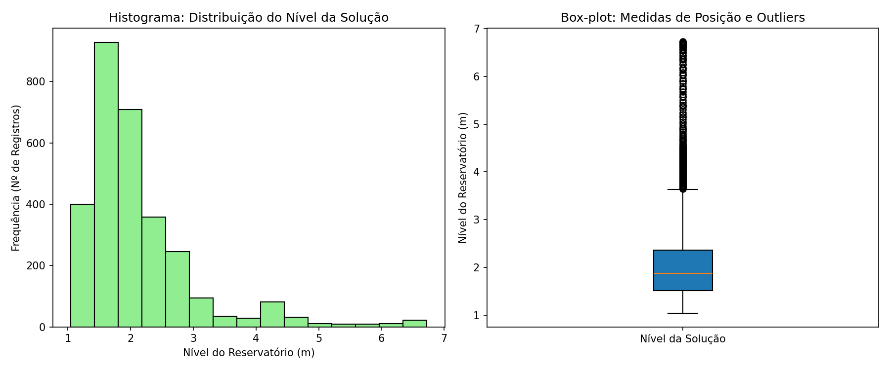
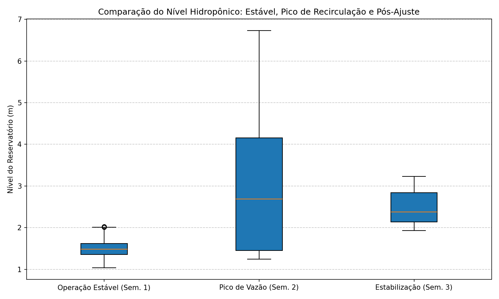
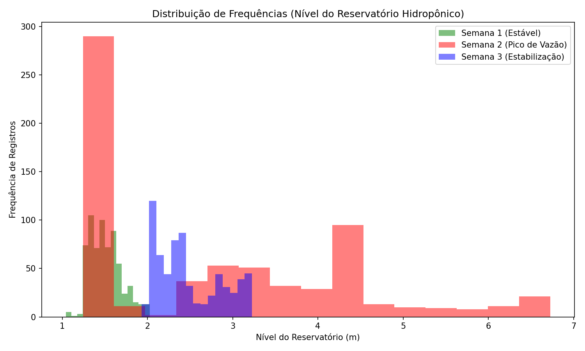
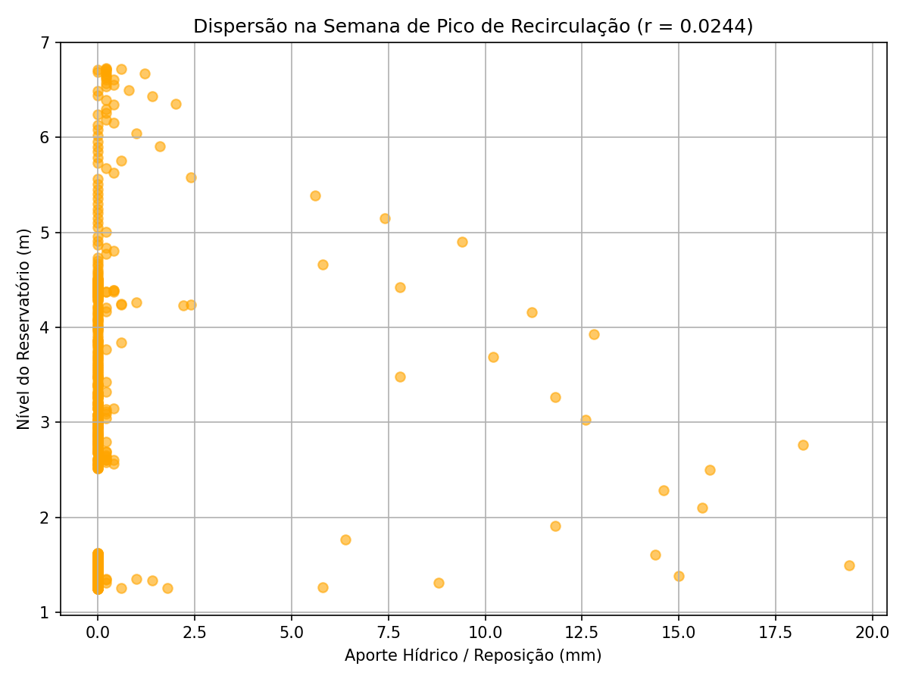

# 🌱 Análise Estatística e Monitoramento Hídrico em Sistema de Hidroponia


---

## 📌 Visão Geral do Projeto

Este projeto aplica **Estatística Descritiva, Análise Exploratória de Dados (EDA) e Séries Temporais** para o monitoramento automatizado do **nível de solução nutritiva** e do **aporte/reposição hídrica** em um reservatório de cultivo hidropônico.

A partir de leituras telemétricas coletadas a cada 15 minutos (`2.976` registros mensais), o pipeline em **Python (`Pandas`, `NumPy` e `Matplotlib`)** avalia:
1. **Qualidade da Telemetria e Sensores (`analise_mensal_hidroponia.py`):** Distribuição de frequências da integridade das leituras, medidas de tendência central (média e mediana), separatrizes (quartis $Q_1, Q_3$) e dispersão (desvio padrão e coeficiente de variação).
2. **Estudo Comparativo Operacional em 3 Semanas (`analise_comparativa_semanal.py`):** Comparação estatística entre três regimes operacionais do reservatório: **Semana 1 (Operação Estável)**, **Semana 2 (Pico de Vazão / Recirculação)** e **Semana 3 (Estabilização Pós-Ajuste)**.
3. **Análise de Correlação Linear ($r$ de Pearson):** Investigação da relação instantânea entre o aporte de reposição hídrica (mm) e a variação imediata do nível do reservatório principal (m), evidenciando a inércia hidráulica do circuito de recirculação.

---

## 📊 Principais Resultados Estatísticos

### 1. Estatística Descritiva Mensal (`analise_mensal_hidroponia.py`)
- **Total de Leituras Analisadas no Mês:** `2.976` registros (intervalos de 15 min)
- **Média do Nível ($\bar{x}$):** `2,1211 m`
- **Mediana ($Q_2$):** `1,8834 m` *(assimetria positiva provocada pelos períodos de sobrecarga de recirculação)*
- **1º Quartil ($Q_1 - 25\%$):** `1,5202 m`
- **3º Quartil ($Q_3 - 75\%$):** `2,3671 m`
- **Desvio Padrão ($s$):** `0,9055 m`
- **Coeficiente de Variação ($CV$):** **`42,69%`**



---

### 2. Comparativo por Regime Operacional (`analise_comparativa_semanal.py`)

O monitoramento comparativo entre três janelas consecutivas de 7 dias demonstra a sensibilidade das métricas de dispersão para detecção de anomalias de vazão:

| Métrica Estatística | 🟢 Semana 1 — Operação Estável | 🔴 Semana 2 — Pico de Vazão | 🔵 Semana 3 — Estabilização |
| :--- | :---: | :---: | :---: |
| **Média ($\bar{x}$)** | `1,5091 m` | **`2,8414 m`** | `2,4859 m` |
| **Mediana ($Q_2$)** | `1,4844 m` | **`2,6879 m`** | `2,3789 m` |
| **1º Quartil ($Q_1$)** | `1,3586 m` | `1,4544 m` | `2,1396 m` |
| **3º Quartil ($Q_3$)** | `1,6201 m` | **`4,1570 m`** | `2,8415 m` |
| **Nível Máximo** | `2,0270 m` | **`6,7267 m`** | `3,2275 m` |
| **Desvio Padrão ($s$)** | `0,1833 m` | **`1,5223 m`** | `0,3761 m` |
| **Coeficiente de Variação ($CV$)** | `12,15%` *(Baixa dispersão)* | **`53,57%`** *(Alta variabilidade)* | `15,13%` *(Controle retomado)* |

#### Interpretação Técnica:
1. **Regime Nominal (Semana 1 — `CV = 12,15%`):** O reservatório mantém nível controlado em torno de `1,51 m`, com distância interquartil ($Q_3 - Q_1$) de apenas `0,26 m`.
2. **Detecção de Sobrecarga (Semana 2 — `CV = 53,57%`):** O desvio padrão aumenta mais de 8 vezes (`0,18 m` $\rightarrow$ `1,52 m`), sinalizando oscilação abrupta no volume retido.
3. **Amortecimento e Estabilização (Semana 3 — `CV = 15,13%`):** A dispersão retorna à faixa de estabilidade (`< 16%`), operando em novo patamar de equilíbrio (`2,49 m`).




---

### 3. Análise de Correlação ($r$ de Pearson) e Inércia Hidráulica

- **Correlação Mensal:** $r = 0,0571$
- **Correlação na Semana de Pico:** $r = 0,0244$

> **Conclusão Estatística:** O baixo valor do coeficiente de correlação linear instantâneo ($r \approx 0,02\text{ a }0,06$) demonstra a **defasagem temporal (*lag time*)** entre o acionamento do aporte hídrico e a resposta de nível no tanque principal, uma vez que o volume circula pelas bancadas hidropônicas antes de retornar ao reservatório de medição.



---

## 📂 Estrutura do Repositório

```text
├── analise_mensal_hidroponia.py     # Estatística descritiva, frequência qualitativa e correlação mensal
├── analise_comparativa_semanal.py   # Comparativo entre as 3 semanas operacionais (Box-plot e Histogramas)
├── boxplot_comparativo.png          # Box-plot comparativo das 3 janelas semanais
├── histograma_comparativo.png       # Distribuição de frequências sobreposta das 3 semanas
├── graficos_quantitativos.png       # Histograma e Box-plot da distribuição do nível
├── grafico_qualitativo.png          # Distribuição de qualidade dos registros telemétricos
├── grafico_dispersao.png            # Dispersão Reposição Hídrica vs. Nível (Mensal)
├── dispersao_semana_pico.png        # Dispersão Reposição Hídrica vs. Nível (Semana de Pico)
└── requirements.txt                 # Dependências Python (pandas, numpy, matplotlib, openpyxl)
```

---

## 🚀 Como Executar

```bash
pip install -r requirements.txt

# 1. Executar análise estatística mensal
python analise_mensal_hidroponia.py

# 2. Executar estudo comparativo das 3 semanas operacionais
python analise_comparativa_semanal.py
```

---

## 👤 Autor

**Isaac Salles Gonçalves** (`@totemicpuma`)
- Instituto Federal Fluminense (IFF)
